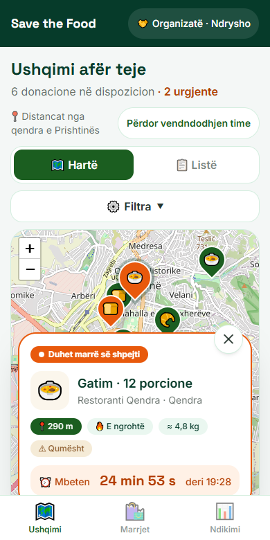
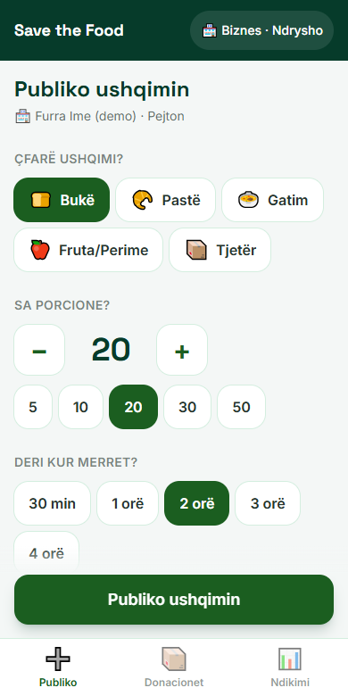
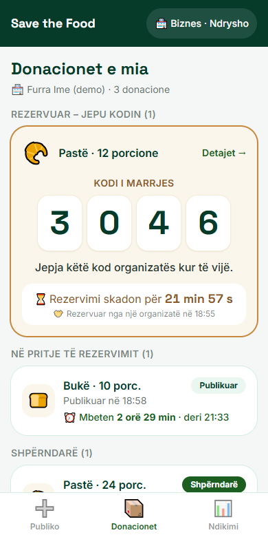
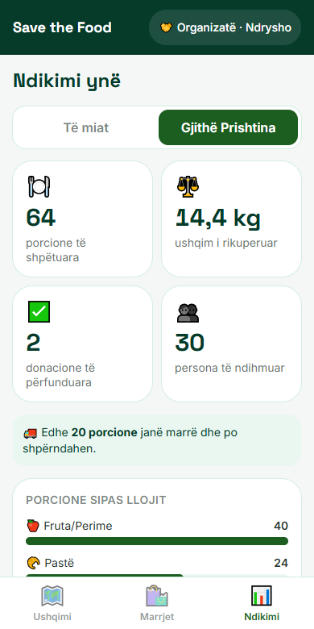

<div align="center">


# Save the Food

**Ushqimi që mund të ndihmojë dikë nuk duhet të bëhet mbeturinë.**

Platformë civic-tech në Prishtinë që lidh furrat, restorantet, marketet dhe hotelet
që kanë ushqim të tepërt me organizatat humanitare dhe vullnetarët, para se ushqimi të humbasë.

🌐 **Demo:** _(linku shtohet pas publikimit)_

</div>

---

## Problemi

Çdo pasdite në Prishtinë mbetet ushqim i sigurt dhe cilësor që përfundon në kontejner,
ndërsa strehimoret, kuzhinat popullore dhe familjet në nevojë kërkojnë ndihmë çdo ditë.
Teprica ekziston dhe nevoja ekziston. Mungon një **lidhje e shpejtë** mes tyre.

## Si funksionon

```
🏪 Biznesi publikon  →  🗺️ Shfaqet në hartë  →  🤝 Rezervohet  →  🔢 Merret me kod  →  👥 Shpërndahet
```

1. **Biznesi** publikon tepricën për më pak se 60 sekonda, vetëm me butona.
2. **Organizata ose vullnetari** e gjen në hartë dhe e rezervon. Ka 30 minuta kohë për ta marrë.
3. Te biznesi, marrja konfirmohet me një **kod 4-shifror** që e sheh vetëm biznesi.
4. Pas shpërndarjes shënohet sa persona u ndihmuan, dhe **paneli i ndikimit** rritet.

## Pamje

| Harta | Publikimi | Kodi i marrjes | Ndikimi |
|:---:|:---:|:---:|:---:|
|  |  |  |  |

## Funksionet (Faza 1)

- ⚡ **Publikim për 60 sekonda:** lloji, porcionet, afati, ruajtja, alergjenët (të detyrueshëm) dhe shënimi.
  Kilogramët vlerësohen automatikisht dhe mund të ndryshohen.
- 🗺️ **Hartë dhe listë** me pin për çdo donacion, filtra (lloji, distanca, urgjenca) dhe distancë nga vendndodhja jote.
- ⏰ **Numërim mbrapsht** dhe etiketa **"Duhet marrë së shpejti"** kur mbeten më pak se 60 minuta.
- 🔄 **Statuset:** Publikuar → Rezervuar → Marrë → Shpërndarë. Rezervimi skadon vetë pas 30 minutash.
- 🔢 **Kod 4-shifror** për konfirmimin e marrjes.
- 📊 **Paneli i ndikimit:** porcione të shpëtuara, kg, donacione të përfunduara dhe persona të ndihmuar.
- 👤 **Tri role:** Biznes, Organizatë, Vullnetar (pa login të vërtetë në këtë fazë).
- 📱 **Mobile-first:** butona të mëdhenj për duar të zëna, një veprim kryesor për ekran.

## Teknologjitë

| | |
|---|---|
| Ndërfaqja | [React](https://react.dev) + [Vite](https://vite.dev) (JavaScript) |
| Stilet | [Tailwind CSS](https://tailwindcss.com) v4 |
| Harta | [React-Leaflet](https://react-leaflet.js.org) + [OpenStreetMap](https://www.openstreetmap.org) |
| Navigimi | [React Router](https://reactrouter.com) |
| Publikimi | [Vercel](https://vercel.com) |

Në Fazën 1 të dhënat ruhen në `localStorage` të shfletuesit, me të dhëna shembull që rifreskohen vetë.
Skedat e hapura sinkronizohen menjëherë me njëra-tjetrën.

## Nise në kompjuterin tënd

Të duhet [Node.js](https://nodejs.org) 20 ose më i ri.

```bash
git clone https://github.com/luanasherifi12-sys/save-the-food.git
cd save-the-food
npm install
npm run dev
```

Pastaj hap **http://localhost:5173**.

> 💡 **Provë e shpejtë:** hap dy dritare (njëra normale, tjetra Incognito). Në njërën zgjidh **Biznes**,
> në tjetrën **Vullnetar**. Publiko, rezervo, fut kodin dhe shiko si ndryshon gjithçka live.

## Struktura

```
src/
├── pages/        Një fajll për çdo ekran (Publiko, Ushqimi, Detajet, Marrjet, Ndikimi...)
├── components/   Pjesë të ripërdorshme (kartela, çipa, harta, kodi i marrjes...)
├── hooks/        useDonations, useNow, useUserLocation
├── lib/          Rregullat: statuset, koha, distanca, ndikimi, ruajtja e të dhënave
└── data/         Të dhënat shembull (biznese fiktive në lagje reale të Prishtinës)
```

Gjithë leximi dhe shkrimi i të dhënave kalon nëpër `src/lib/donationsStore.js`,
kështu që kalimi te një databazë e vërtetë ndryshon vetëm një fajll.

## Hapat e ardhshëm

- [ ] **Supabase:** llogari të vërteta, databazë e përbashkët dhe përditësime në kohë reale mes pajisjeve
- [ ] Njoftime për vullnetarët afër kur publikohet ushqim urgjent
- [ ] Verifikimi i profileve të organizatave dhe vullnetarëve
- [ ] Parashikimi i tepricës nga të dhënat e mëparshme
- [ ] Zgjerimi në Prizren, Pejë, Ferizaj, Gjilan dhe qytete të tjera

---

<div align="center">
Ndërtuar me 💚 në Prishtinë nga <a href="https://github.com/luanasherifi12-sys">Luana Sherifi</a>
</div>
